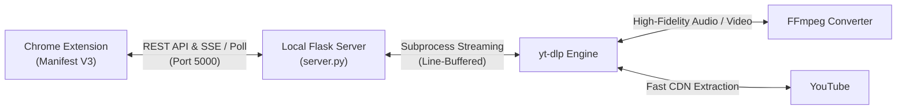

# 🎬 YT-DLP Playlist Downloader (Chrome Extension & Server)

<p align="center">
  
</p>

<p align="center">
  <strong>The fastest, most elegant YouTube playlist & video downloader for Google Chrome.</strong><br>
  Powered by <code>yt-dlp</code> with single-click MP3 320k audio, 4K video quality, live speed indicators, and smart resume.
</p>

<p align="center">
  <a href="https://github.com"></a>
  
  
  
  
</p>

<p align="center">
  🌐 <strong>Landing Page Website:</strong> Check out the included interactive website in <code>website/index.html</code>!
</p>

---

## 🌟 Features at a Glance

- ⚡ **Full Playlists & Channels**: Paste any playlist or channel link to queue 100+ videos in seconds.
- 🎵 **1-Click 320kbps MP3 Audio**: Extract pristine audio with custom bitrate controls (320k, 256k, 192k) and embedded thumbnails.
- 📁 **Smart Folder Scanner (Sync Missing)**: Choose a folder and click `Select Missing` — it scans existing files on your drive and auto-selects only undownloaded items!
- 📊 **Real-Time Speed & Live ETA**: Watch line-buffered download speeds (`MiB/s`), countdown ETA, and downloaded file size streamed directly to your extension popup.
- 🗂️ **Native Windows Folder Dialog**: Choose your download path with the standard Windows Explorer dialog or quick drive presets (`D:\`, Downloads, Music).
- 🔄 **Smart Retry & Resume**: Failed a download due to a WiFi drop? One click retries only failed items without redownloading what succeeded.
- 🚀 **1-Click Zero-Friction Setup**: No manual command-line typing. `setup.bat` configures Python, pip packages, yt-dlp, and creates a desktop shortcut.

---

## 🚀 Quick Setup for Friends (Less than 60 Seconds)

### Step 1: Download & Extract
Download the repository as a ZIP archive from GitHub and extract it to your computer.

### Step 2: Run `setup.bat`
Double-click **`setup.bat`** in the extracted folder.
- Automatically verifies or installs Python.
- Installs `yt-dlp`, `Flask`, and `Flask-CORS`.
- Automatically sets up `ffmpeg` for MP3 conversion.
- Creates a clean **Start YT-DLP Server** shortcut on your Desktop!

### Step 3: Load Extension in Chrome / Edge
1. Open Google Chrome (or Edge / Brave) and navigate to: `chrome://extensions`
2. Turn **ON** the **Developer mode** toggle in the top-right corner.
3. Click the **"Load unpacked"** button in the top-left corner.
4. Select the **`extension`** folder inside this project directory.
5. Pin the extension to your toolbar, open YouTube, and start downloading!

> **💡 Daily Use:** Double-click the **"Start YT-DLP Server"** icon on your Desktop before downloading!

---

## 🏗️ Architecture



---

## 🛠️ Manual Developer Installation

If you prefer using the command line:

```bash
# 1. Clone repository
git clone https://github.com/Ahmedamr3232/play-list-video-downloader-.git
cd play-list-video-downloader-

# 2. Install dependencies
pip install -r requirements.txt

# 3. Start server
python server/server.py

# 4. Open website preview
start website/index.html
```

---

## ⚙️ REST API Endpoints

The local Python server exposes the following endpoints on `http://127.0.0.1:5000`:

| Endpoint | Method | Description |
| :--- | :--- | :--- |
| `/api/health` | `GET` | Health check, detects yt-dlp, ffmpeg, and default download path |
| `/api/fetch-playlist` | `POST` | Fetches metadata, duration, and thumbnail list for a URL |
| `/api/download` | `POST` | Starts a multi-threaded background download session |
| `/api/progress-poll/<id>` | `GET` | Polls real-time download status, percentage, speed, and ETA |
| `/api/active-session` | `GET` | Returns the currently running session to restore UI state |
| `/api/cancel/<id>` | `POST` | Gracefully terminates active yt-dlp process |
| `/api/retry/<id>` | `POST` | Restarts failed items from a previous session |
| `/api/browse-folder` | `GET` | Opens native Windows folder browser dialog |
| `/api/open-folder` | `POST` | Opens destination directory in Windows Explorer |
| `/api/scan-folder` | `POST` | Scans directory and matches existing filenames against playlist |
| `/api/history` | `GET` | Returns list of past download sessions |

---

## ❓ Frequently Asked Questions

<details>
<summary><strong>Do my friends need to know Python or programming?</strong></summary>
No! <code>setup.bat</code> handles everything automatically: it checks Python, installs all libraries with <code>pip</code>, updates <code>yt-dlp</code>, and places a ready-to-use shortcut on their Desktop.
</details>

<details>
<summary><strong>Can I extract only the audio (MP3)?</strong></summary>
Yes! Switch the format tab to <strong>Audio (MP3)</strong> in the popup. You can select 320kbps (pristine quality), 256kbps, or 192kbps.
</details>

<details>
<summary><strong>What happens if my download gets interrupted?</strong></summary>
Simply click <strong>Retry Failed</strong> or use <strong>Select Missing</strong>. It scans your folder and downloads only the videos that have not completed yet.
</details>

---

## 📄 License

This project is licensed under the [MIT License](LICENSE).
Free to use, share, and customize!
